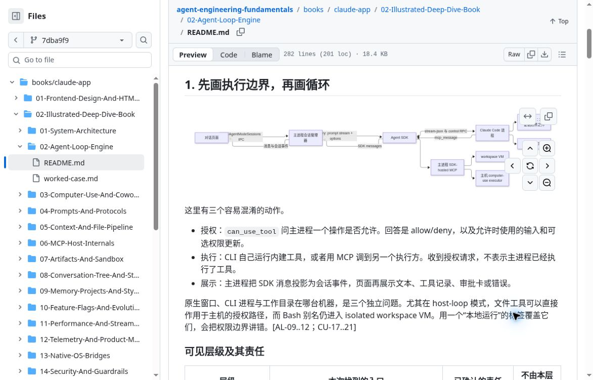
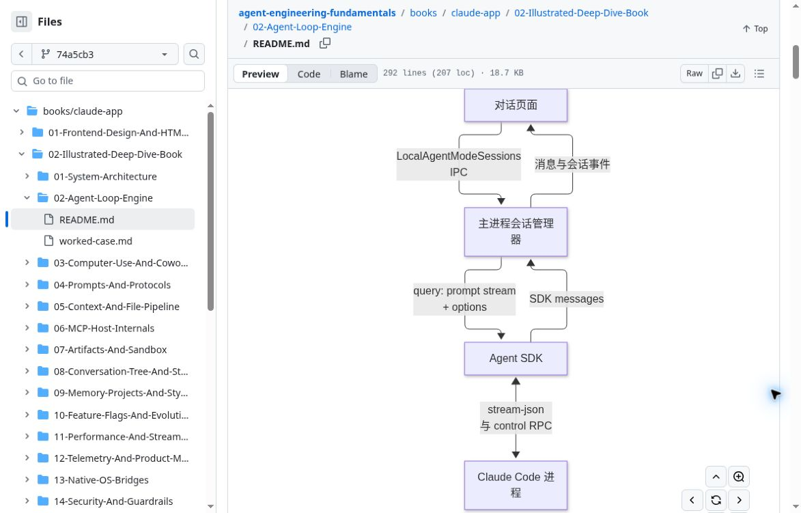

# 图表视觉验证

本附录记录 GitHub README 实际渲染的视觉抽查。范围是各卷选定的首幅 Mermaid 图、为改善阅读而拆出的替代图，以及第18卷的首幅SVG；不代表全书所有图表均经过视觉验收。本批选定图检查于 2026-10-15 完成；结论仅适用于下列抽查范围。原始示例截图为 1173×751 像素，使用默认侧栏和正文布局；截图像素尺寸不等于 CSS 视口尺寸，历史检查未统一记录后者。

## 验证标准与范围

语法检查通过，只说明图可以被解析；实际阅读还需要检查默认正文宽度下的字号、连线、箭头与控件遮挡。默认视图能够顺着页面滚动完整阅读的长图可以通过，不要求整图塞进一个屏幕。展开查看可读、加载后局部恢复，都不能代替默认视图的完整验收。

| 卷次 | 选定图的处理 | 默认阅读结论 |
| --- | --- | --- |
| 1、3、8、9、10、11、12、16 | 保留原图 | 已通过 |
| 2 | 横向总图拆为两幅纵向图：主链与工具路由 | 两图已通过；工具图右下边框与控件轻微重叠，未遮挡文字或箭头 |
| 4、5、6 | 横向布局改为纵向布局 | 已通过 |
| 7 | 两条路径拆为两幅纵向图 | 两图已通过；边框贴近控件，未遮挡文字 |
| 14、15 | 横向布局改为纵向布局 | 已通过 |
| 13 | 保留原图，串行复验 | 已完整通过；字体偏小但可辨，箭头清楚，无控件遮挡 |
| 17 | 初次渲染报错，重新打开并普通刷新一次后恢复 | 恢复后默认视图完整通过；保留运行时错误记录 |
| 18 | 主 README 无 Mermaid，检查已有首张 SVG | SVG 完整通过；不计入 Mermaid 结果 |
| 19 | 保留原图，完整滚动检查 | 已通过；三分支实线与回流虚线可辨 |

## 排版调整示例

第 2 卷原来的横向总图在默认正文宽度下压缩明显，字体偏小，右侧控件遮挡部分节点。修订后按主链和工具路由拆成两幅纵向图，减少横向挤压。这里展示原图与新主链；工具路由的验证结果列在上表，不以单张示例替代两图验收。

第 17 卷首次出现 `Cannot read properties of undefined (reading 'render')` 并降级显示源码；重新打开页面并普通刷新一次后恢复，上中下完整滚动可读，分支和箭头清楚，没有截字或控件遮挡。因此结论是“恢复后默认视图通过”，并非首次加载无异常。第 18 卷 SVG 与第 19 卷 Mermaid 均完整滚动检查通过；这三卷均未使用展开或缩放。第 17、18 卷的小字略小但可辨。

具体修订版本及证据索引见[结构化记录](data/diagram-visual-review.json)。第 13 卷串行复验无需展开或刷新，默认正文可完整阅读。第 14、15、16 卷在串行复验时均无需展开，且未出现崩溃；第 16 卷保留原有纵向布局。先前观察到的 iframe 异常仅记作运行时现象，不推断其原因。截图反映当时的 GitHub 渲染状态；渲染器异常与源码语法错误分别记录，恢复后仍须完整滚动检查，不能只凭恢复或展开成功判断默认阅读通过。
