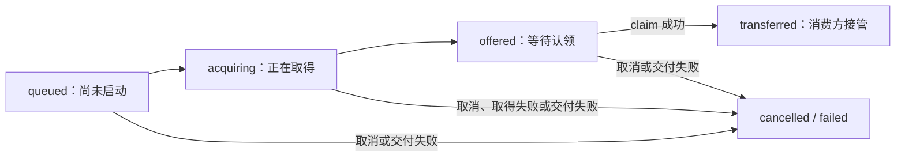
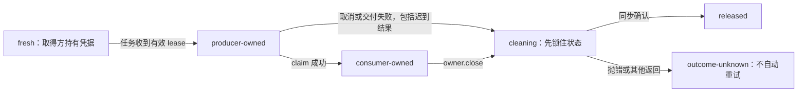

# Promise 到达之后，资源还归谁？

这是补足 `callback-gate.mjs` 的原创小实验。旧模型只阻止过期回调；这里单独管理“一次取得的资源，最终由谁释放”。不复制产品代码，不打开真实 fd，不调用 Node-API，也不是 Node-API 的替代实现。

核心只有一句：**Promise 交出 offer，接收方显式 `claim()` 才接管资源。** `resolve`、回调正常返回、数字句柄出现，都不是本模型的所有权转移点。

## 先定合同

1. `createLease(cleanup)` 为一次独占资源创建不透明凭据。凭据没有 fd、操作方法或可伪造的编号。两个 lease 不得指向同一底层资源；模型不能替调用方发现这种别名。
2. `startHandoff({ acquire })` 在微任务开始调用取得函数；它可以异步返回一个从未交付过的 lease。取得函数若拒绝，必须自行释放尚未交出的资源。模型无法回收它从未看见的东西。
3. `task.ready` 最终给出 offer 或 `null`，不交出资源所有权。`offer.claim()` 同步返回 owner，失败返回 `null`；成功后只有 owner 负责 `close()`。转移过程中不调用外部代码。
4. `task.cancel()` 和 `task.failDelivery(error)` 在 claim 前终止交付。返回 `true` 只表示请求被本模型接受，**不表示 worker 已停止或资源已释放**。取得已启动时，`ready` 会等它结束，迟到资源仍须清理。取得永不结束，`ready` 也会一直等待。
5. 清理回调必须同步；只有明确返回 `RELEASE_CONFIRMED` 才记为已释放。抛错或任何其他返回值都记为 `outcome-unknown`，不会自动重试。异步清理不在成功合同内；若意外返回 Promise/thenable，模型会尽力观察其兑现/拒绝并记入 `returnObservation`；普通返回 Promise 的拒绝会被接住并保留诊断。观察会触发 then getter/then 回调，因此在此之前已经锁定 unknown；晚到的确认值不会把它改为 released，也不会触发重试。若 Promise 的 constructor/species 等自定义机制阻止安装观察器，会记录 observation-failed，不能保证该对象的后续拒绝被接住；回调内部创建却没有返回的 Promise 也无法观察。不要把这个诊断机制当作异步清理支持。
6. 清理前先置为 `cleaning`。清理内部重入 `close()` 或 `cancel()` 不会再调用清理。重入的 `close()` 得到的是当时的 `cleaning` 快照；外层完成后须重新 `inspect()`，不能把旧快照当最终状态。

这里证明的是**每个合法 lease 最多调用一次注入清理函数**，不是“底层资源恰好释放一次”。回调可能在释放前抛错，也可能在释放后抛错；两者对模型都是未知。若回调谎报确认、创建重复别名、绕过 owner 手动释放，或进程突然退出，本模型没有全能保障。

## 两条状态线

任务线记录交付过程；资源线记录仍需谁负责，二者不能合并成一个“完成”布尔值。





纯文本备份：任务 queued → acquiring → offered → transferred，claim 前可进入 cancelled / failed；资源 fresh → producer-owned → consumer-owned，后两者可进入 cleaning，再进入 released 或 outcome-unknown。两条线的 claim 指同一次同步转移。

- queued 时取消：取得函数不会执行，不存在待回收资源。
- acquiring 时取消：先拒绝今后交付；取得稍后成功，仍先收下 lease 再清理。
- offered 时取消或交付前失败：生产方清理，旧 offer 的 claim 失效。
- claim 成功：任务保留 transferred；之后取消/失败请求返回 false，不夺回资源。
- 消费方拿到 owner 后抛错：所有权不回滚。接收方用自己的 try/finally 负责 close。
- Promise 已经兑现后取消：Promise 不能倒退，但 offer 可撤销；必须查看 claim 的实际返回值。
- 接收方既不 claim，也不 cancel/failDelivery：资源会继续留在 producer-owned。调用方必须明确处理，模型没有超时或 GC 兜底，不能证明最终一定释放。

## 最小用法

```js
import { createLease, startHandoff, RELEASE_CONFIRMED } from './resource-handoff.mjs';

const task = startHandoff({
  acquire: async () => createLease(() => {
    // 在这里调用合成资源的释放操作；本实验不接触真实 fd。
    return RELEASE_CONFIRMED;
  }),
});
const offer = await task.ready;
const owner = offer?.claim();
if (owner) {
  try {
    // 消费方已经接管；演示模型只提供 close/inspect，不提供原生操作。
  } finally {
    const result = owner.close();
    // outcome-unknown 需要报告与真实资源合同支持的调查，不能盲目重试。
    console.log(result.state);
  }
}
```

API 没有“调用一个用户回调，若抛错就假定没接管”的捷径。交付前失败用明确的 `failDelivery(error)` 表示；接收后的错误属于接收方。`ready` 是一次历史里程碑，`task.inspect()` 和 `owner.inspect()` 才是当前快照。

## 为什么不按 fd 数字去重？

数字 7 可以先表示资源 A，A 释放后又分配给资源 B。若对旧的“7”再次执行关闭，可能误关 B。本实验让旧 owner 永远对应旧 lease；重复 close 不再调用清理，因此不会因相同数字去关闭新 lease。

这不是给真实 fd 增加了 OS 级代数编号。清理函数仍须捕获正确的资源身份；测试中的 generation 仅是合成注册表里的身份标记，不代表操作系统提供同样能力。外部代码直接关闭或复用真实句柄造成的竞态不在模型证明范围内。

## 运行与阅读顺序

进入本目录后，使用 Node.js 22+（已在 24.19.0 核验；测试使用 Promise.withResolvers）；无需安装或联网：

```sh
node --unhandled-rejections=strict --test *.test.mjs
node --unhandled-rejections=strict demo.mjs
```

先读本页合同，再看实现中的 `stop`、`claim`、`release`，最后运行合成反例。测试覆盖取得前后取消、Promise 兑现但未接管、交付前失败、接管后异常、重入和清理结果未知、重复凭据、数字复用，以及取得函数隐匿资源的边界。

这些测试只验证原创的单 JS 线程状态机，不证明产品的真实取消链、fd 泄漏、线程同步、环境拆除、TSFN 入队或 Node-API deferred 生命周期。将它用于 native 设计时，必须另行证明生产者停止协议、队列接管合同、原生资源操作的确切成功/失败含义。
