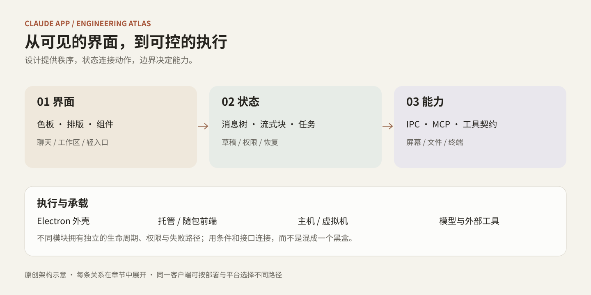
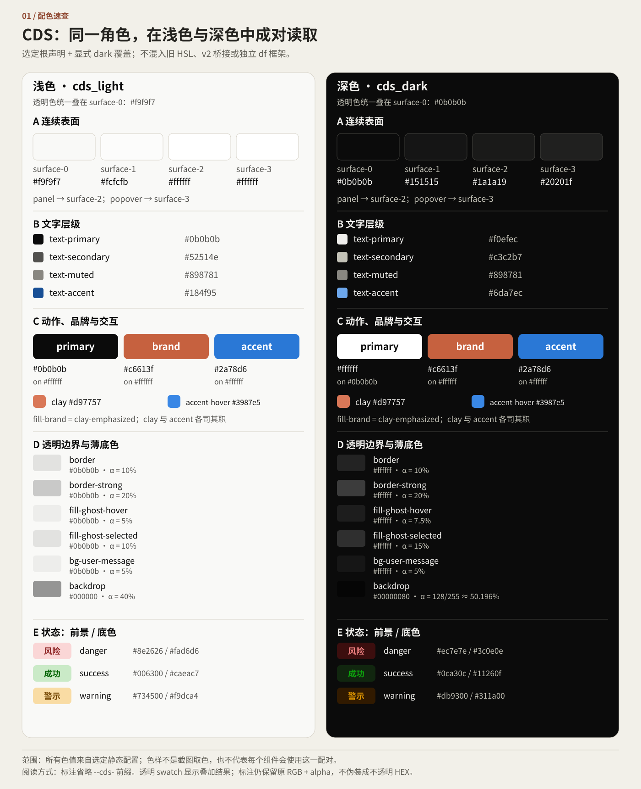
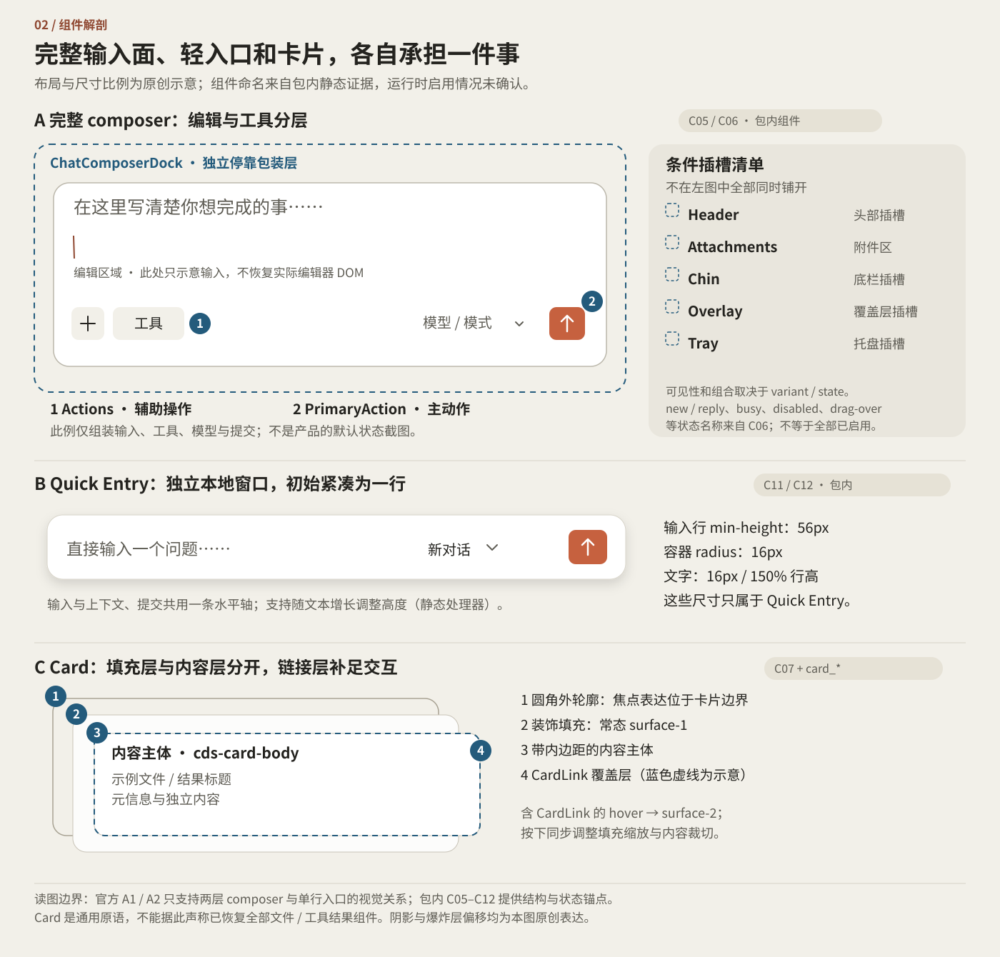
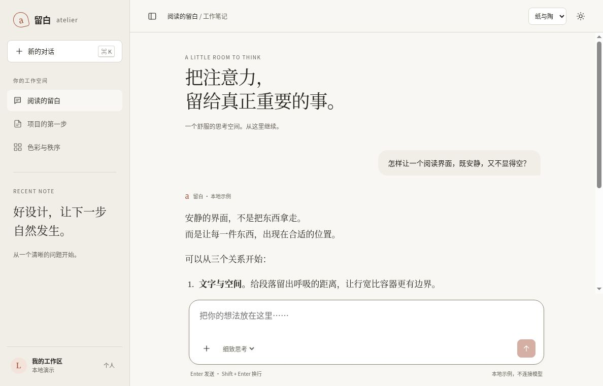

# 拆开 Claude App

### 从一块温暖的背景色，到一套能执行任务的桌面系统

这本书把 Claude App 拆成两条阅读路线：**看得见的设计，拿来做网页；看不见的机制，拿来做系统。** 色板、组件、状态机和代码放在一起，读完一节就能进入对应的实现。

## 先挑一个入口

| 想做什么 | 直接打开 | 一句话精华 |
|---|---|---|
| 做一个有阅读感的网页 | [前端审美与设计系统](01-Frontend-Design-And-HTML-Templates/README.md) · [设计速查](01-Frontend-Design-And-HTML-Templates/quick-reference.md) | 温暖来自大面与文字的关系，不来自把每个按钮染成橙色 |
| 看组件怎样响应操作 | [原创交互工作台](01-Frontend-Design-And-HTML-Templates/interactive-study/index.html) · [运行说明](01-Frontend-Design-And-HTML-Templates/interactive-study/README.md) | 密度、阅读字号、输入状态和 Quick Entry 可以独立研究 |
| 理解桌面产品的内部组织 | [技术全书目录](02-Illustrated-Deep-Dive-Book/README.md) | 窗口、内容、能力与执行拥有不同的生命周期 |
| 让另一个 agent 接着做 | [Skills 导航](03-Ready-To-Use-Agent-Skills/README.md) | 把选型依据、反例和代码入口一起交给 agent |
| 一条命令比较新旧版本 | [自动逆向工具箱](05-Automated-Reverse-Toolkit/README.md) | 受限解包、静态快照与可追溯的配色/开关/契约/遥测差分 |
| 复算参数或研究新版本 | [代码与脚本](04-Extracted-Core-Code-And-Scripts/README.md) | 重要结论能追到输入，也能从输入重新算出来 |

## 前端：先看图，再看代码

- [色块与边界](assets/figures/color-block-anatomy.svg)：阅读画布、消息、输入区与临时浮层，各自承担什么。
- [密度与文字](assets/figures/density-comparison.svg)：控件密度与长文阅读不必绑在一起。
- [五套原创配色配方](01-Frontend-Design-And-HTML-Templates/palette-recipes/README.md)：直接看到浅深色搭配、精确色值与排版参数。
- [基础样式](01-Frontend-Design-And-HTML-Templates/styles/README.md)：变量、组件与页面布局的三层分工。

[完整交互色表](01-Frontend-Design-And-HTML-Templates/color-catalog/index.html)已可使用：315 个原始色阶，连同主题与桥接记录共 1,341 项。六套零依赖 HTML 模板可直接下载打开；模板内嵌 CSS 和 JavaScript，交互只使用本地演示数据。

- [组件交互画廊](01-Frontend-Design-And-HTML-Templates/templates/01-component-gallery.html)
- [对话工作台](01-Frontend-Design-And-HTML-Templates/templates/02-chat-workspace-template.html)
- [分屏代码与预览](01-Frontend-Design-And-HTML-Templates/templates/03-split-artifact-ide-template.html)
- [技术博客与文档](01-Frontend-Design-And-HTML-Templates/templates/04-editorial-blog-and-doc-template.html)
- [设置与数据看板](01-Frontend-Design-And-HTML-Templates/templates/05-settings-and-dashboard-template.html)
- [Quick Entry 指令面板](01-Frontend-Design-And-HTML-Templates/templates/06-floating-launcher-template.html)

## 模板实景

[查看六套模板截图与用法](01-Frontend-Design-And-HTML-Templates/templates/README.md#浏览器实景)

## 技术全书：十卷主线，专题补充

| 卷 | 主题 | 要解决的问题 |
|---|---|---|
| 01 | [整体架构与多进程协同](02-Illustrated-Deep-Dive-Book/01-System-Architecture/README.md) | 一个窗口后面，哪些东西一起活、哪些东西分别活？ |
| 02 | [Agent Loop 与执行状态机](02-Illustrated-Deep-Dive-Book/02-Agent-Loop-Engine/README.md) | 一次回复结束，为什么执行进程未必结束？ |
| 03 | [Computer Use 与 Cowork](02-Illustrated-Deep-Dive-Book/03-Computer-Use-And-Cowork/README.md) | 主机、虚拟机、终端和屏幕操作怎样分工？ |
| 04 | [Prompt、工具契约与解析](02-Illustrated-Deep-Dive-Book/04-Prompts-And-Protocols/README.md) | 从连续字节到可执行动作，中间有哪些结构边界？ |
| 05 | [上下文与文件管线](02-Illustrated-Deep-Dive-Book/05-Context-And-File-Pipeline/README.md) | 拖入一个文件后，哪些工作在本地，哪些交给服务？ |
| 06 | [MCP 宿主与扩展](02-Illustrated-Deep-Dive-Book/06-MCP-Host-Internals/README.md) | 安装一个工具，为什么还不等于可以调用它？ |
| 07 | [Artifacts 与预览沙盒](02-Illustrated-Deep-Dive-Book/07-Artifacts-And-Sandbox/README.md) | 怎样让生成代码可见、可交互，又不拿到宿主能力？ |
| 08 | [对话分支与流式渲染](02-Illustrated-Deep-Dive-Book/08-Conversation-Tree-And-Streaming/README.md) | 编辑、重试和连续输出如何保持一致？ |
| 09 | [Memory、Projects 与 Styles](02-Illustrated-Deep-Dive-Book/09-Memory-Projects-And-Styles/README.md) | 跨对话信息和当前轮输入怎样分层组织？ |
| 10 | [Feature Flags 与配置演化](02-Illustrated-Deep-Dive-Book/10-Feature-Flags-And-Evolution/README.md) | 开关、能力与产品入口如何组合，代码能说明什么？ |
| 11 | [流式性能与分层调度](02-Illustrated-Deep-Dive-Book/11-Performance-And-Streaming/README.md) | 稳定块、活动尾部、Worker 与图表队列怎样减少重复工作？ |
| 13 | [原生系统桥接](02-Illustrated-Deep-Dive-Book/13-Native-OS-Bridges/README.md) | 窗口上下文、选择文字与最终编辑目标如何保持同一身份？ |
| 14 | [安全防线与执行边界](02-Illustrated-Deep-Dive-Book/14-Security-And-Guardrails/README.md) | 内容、权限、资源身份与执行之间，哪些检查不能省？ |
| 15 | [语音与视觉数学](02-Illustrated-Deep-Dive-Book/15-Voice-And-Vision-Math/README.md) | 采样、播放、像素、显示器与文档坐标如何换算？ |
| 16 | [恢复、限流与配额](02-Illustrated-Deep-Dive-Book/16-Resilience-And-Quota/README.md) | 断网以后，怎样先判断已经完成的工作，再决定重试？ |
| 17 | [状态、恢复与更新](02-Illustrated-Deep-Dive-Book/17-State-Recovery-And-Updates/README.md) | 网络失败、配置损坏、崩溃与升级分别怎样处理？ |
| 18 | [版本与跨平台](02-Illustrated-Deep-Dive-Book/18-Versions-And-Cross-Platform/README.md) | 三个平台共享哪些字节，又保留哪些系统差异？ |

## 读完最值得带走的六件事

1. **一轮结束，不等于进程结束。** 把 session、一次执行和进程复用分别建模，停止时让旧异步结果失效。
2. **安装成功，不等于工具可调用。** 安装、启用、配置、连接和具体动作授权，是五道不同的门。
3. **网络分块不是字符、事件或 token。** UTF-8 解码、SSE 分帧、内容块归约与界面绘制，各自维护自己的边界。
4. **对话分支首先是身份问题。** 编辑、重试和选择历史，必须明确父节点、临时节点与当前可见路径。
5. **预览安全不止检查来源。** 同一个 iframe 里的旧内容请求也可能晚到；内容代次与请求归属值得单独设计。
6. **审美可以变成可操作的参数。** 表面、文字、边框、动作分别命名；阅读字号和控件密度分别控制，主题切换才不会变成整页换色。

## 使用这份材料

下载 `books/claude-app/` 即可保留书、图和示例。原创代码用于解释机制和独立开发；产品源码定位、版本范围与核验记录集中在[证据附录](04-Extracted-Core-Code-And-Scripts/evidence/README.md)，不打断正文。

主样本：Claude Desktop 2.37337.1，覆盖 Linux、Windows、macOS 包；公开移动端与网页资料按各自来源日期记录。[来源索引](04-Extracted-Core-Code-And-Scripts/evidence/sources.md)

- [第 19 卷：移动端交互边界](02-Illustrated-Deep-Dive-Book/19-Mobile-Surfaces/README.md)

[一条命令运行原创模型与 skills](04-Extracted-Core-Code-And-Scripts/README.md#一条命令运行已收录的原创模型)
